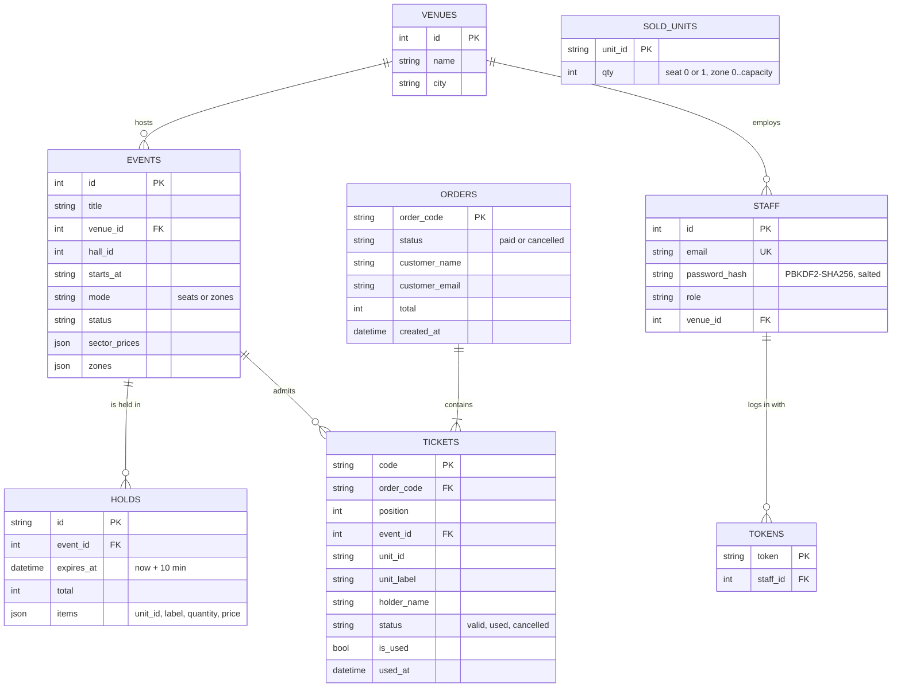

# Database schema

Source of truth: `backend/app/db_models.py` (SQLAlchemy 2.0, portable types, SQLite today, any SQL database later).
Money is an integer number of KZT. Timestamps are stored as UTC.

## Design notes

- **Units.** Seats and zones are "sellable units" generated from the event (`1-A-1`, `3-zone-2`), so there is no
  separate seat table. `SOLD_UNITS` counts what is sold; active `HOLDS` count what is temporarily taken.
  Availability = capacity - sold - held (held ignores holds whose `expires_at` has passed).
- **No double selling.** Hold creation checks and takes units inside one transaction guarded by a lock
  (SQLite has a single writer). On PostgreSQL the lock becomes `SELECT ... FOR UPDATE`.
- **Decline path.** A declined card creates no order and no ticket; the hold keeps running.
- **Venue isolation.** Staff belong to one venue; the scanner rejects events of other venues (403) and treats
  tickets of other venues as INVALID.
